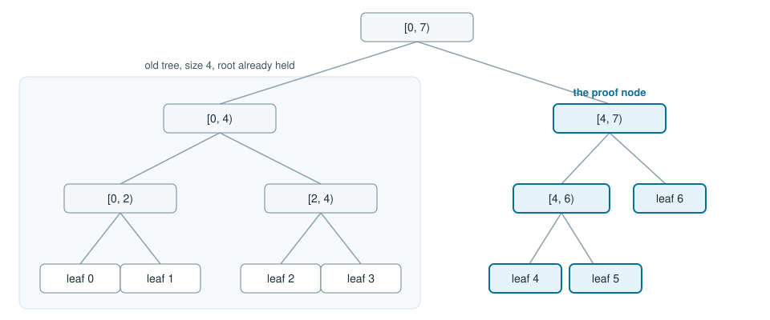

# Consistency proofs

A consistency proof shows that a tree of `old` leaves with root `old_root` is a prefix of a tree of `new` leaves with root `new_root`. [`consistency_proof`](../reference/rfc9162.md) builds the node list from the newer leaf slice. [`verify_consistency`](../reference/rfc9162.md) recomputes both roots from that list. `old` of 0, or `old` greater than `new`, returns `None` from the builder and false from the verifier. Equal sizes verify when the path is empty and the two roots are equal.

The nodes are the RFC 9162 section 2.1.4 sub-proof. When `old` is a power of two, the old tree is a complete left subtree and the proof omits its root: the verifier starts from the root it already holds. Otherwise the first node of the proof is the hash the verifier uses as that seed.

## From size 4 to size 7

Four is a power of two. The old tree is the subtree `[0, 4)`. The proof is one node, the root of `[4, 7)`.

The highlighted node is the whole addition: leaves 4, 5 and 6, folded. The verifier hashes it to the right of the old root and gets the new root. `shape.rs` compares `consistency_proof(..., 4)` with `root` over leaves 4 through 6.

## From size 5 to size 7

Five falls between powers of two, so the old tree ends inside a larger subtree. The proof has four nodes:

1. leaf 4
2. leaf 5
3. leaf 6
4. the root of `[0, 4)`

The first node seeds the old-root calculation. The last node is the left subtree the new root still depends on. `shape.rs` compares this list to `consistency_proof(..., 5)`.

## From size 3 to size 4

This is the step in [getting started](../getting-started.md). The leaves are `alpha`, `beta`, `gamma`, then `delta`. The proof has three nodes:

1. the leaf hash of `gamma`
2. the leaf hash of `delta`
3. the node over `alpha` and `beta`

The program prints `steps 3` and `ok true`. Swapping the sizes fails the check, which the [tree how-to](../howto/rfc9162.md) prints as `swapped sizes false`.

A tile reader builds the same list with `Reader::consistency`. The [tutorial](../tutorials/build-a-log.md) checks the size-3 root against the size-4 root after appending `delta`.
