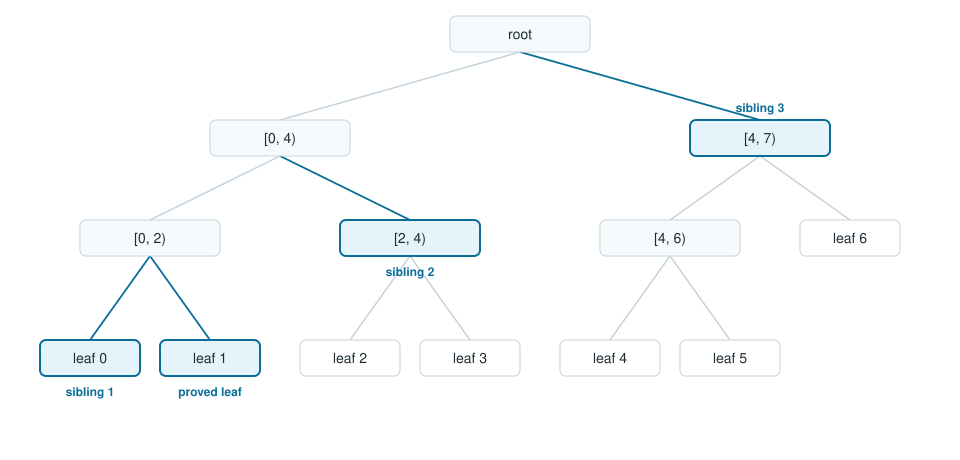

# Inclusion proofs

An inclusion proof for index `i` in a tree of size `n` is the list of sibling subtree roots from that leaf to the root, innermost first. [`inclusion_proof`](../reference/rfc9162.md) builds it from a leaf slice. [`verify_inclusion`](../reference/rfc9162.md) folds a leaf, an index, a size and that list back to a root, and compares the result with the published hexadecimal root.

The fold follows RFC 9162 section 2.1.3. At each step the current index and the last index in the level decide the side: a right-hand node, or the last node on the level, takes its sibling from the left. Any other node takes its sibling from the right. A path that is shorter or longer than the walk returns false. A leaf, index or root other than the ones the proof was built for returns false. The [tree how-to](../howto/rfc9162.md) prints those results.

## Leaf 1 in a tree of seven

The proof for leaf 1 is three hashes, in this order:

1. leaf 0, the sibling under `[0, 2)`
2. the root of `[2, 4)`
3. the root of `[4, 7)`

`docs/examples/tests/shape.rs` builds those three nodes with `root` over the same ranges and compares them to `inclusion_proof`. The walk hashes leaf 0 on the left of leaf 1, then `[2, 4)` on the right of that node, then `[4, 7)` on the left, because the node over `[0, 4)` is the last node on its level in a tree of seven.

## Beta in the three-record tree

In the [getting started](../getting-started.md) tree, `beta` is index 1 of three leaves. The proof is `[leaf(alpha), leaf(gamma)]`. `alpha` joins on the left. `gamma` joins on the left of the node over `alpha` and `beta`, because that node is the last node on its level. The program prints `steps 2` for `alpha` and `beta`, and `steps 1` for `gamma`: `gamma`'s only sibling is the node over `alpha` and `beta`.

The [tutorial](../tutorials/build-a-log.md) reads the same path from tiles. `Reader::inclusion` returns the bytes `inclusion_proof` returns over the flat slice, and `verify_inclusion` accepts them for the stored root.
