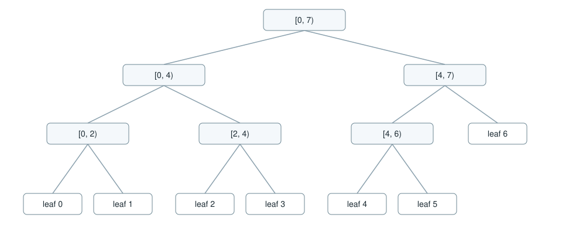
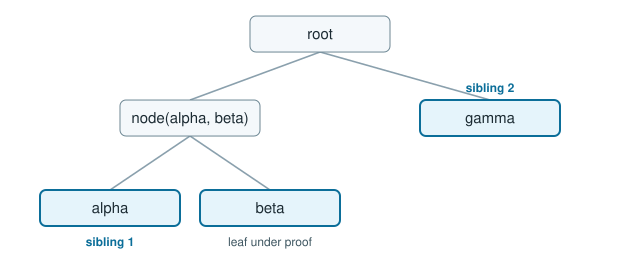

# The Merkle tree

RFC 9162 section 2.1 defines one tree over a sequence of leaf hashes. The crates follow that definition. A tree of seven leaves shows the rule that matters: the split is the largest power of two strictly below the width, and a leftover leaf sits beside a subtree.

Seven leaves split at 4. The left subtree is a complete tree of four. The right subtree has three leaves, so it splits at 2: a pair, and leaf 6 beside that pair. Leaf 6 is one level higher than leaves 4 and 5 because it has no sibling at the bottom.

## Hashes

A leaf hash is `SHA-256(0x00 || entry)`, [`leaf_hash`](../reference/rfc9162.md). An interior hash is `SHA-256(0x01 || left || right)`, [`node_hash`](../reference/rfc9162.md). The prefix byte makes the two hashes different functions of their input.

The Merkle tree hash of a slice is:

| Width | Root |
| --- | --- |
| 0 | SHA-256 of the empty input |
| 1 | the leaf hash itself |
| n > 1 | `node_hash` of the root of the left split and the root of the right split |

The empty root is `e3b0c44298fc1c149afbf4c8996fb92427ae41e4649b934ca495991b7852b855`. The leaf hash of an empty entry is `6e340b9cffb37a989ca544e6bb780a2c78901d3fb33738768511a30617afa01d`, and a one-leaf tree of that entry has the same root. Both values are checked by `docs/examples/tests/shape.rs`. The RFC 6962 vectors, which RFC 9162 keeps, are checked in `crates/rfc9162/tests/rfc6962_vectors.rs`.

The split points used above are checked the same way: width 7 splits at 4, width 3 splits at 2, width 4 splits at 2, width 2 splits at 1.

## The three-record tree

[Getting started](../getting-started.md) hashes `alpha`, `beta` and `gamma`. Width 3 splits at 2, so the root is the node hash of `node(alpha, beta)` and the leaf hash of `gamma`.

The root at that size is `385da30f3917282c8939dff851957e519ab1846b1351a14c0adb3b11632742aa`. Adding `delta` makes a complete tree of four, with root `42fc54eeb6352f90cc81fdd5791292cca3974a168208b395b06a76240b24884d`.

[`Head`](../reference/rfc9162.md) is that pair: a size and the hexadecimal root. [`Head::material`](../reference/rfc9162.md) joins a domain, the size and the root with tabs. The tile crate publishes the same size and root as a [checkpoint](checkpoints.md), with the root in base64.

## Where the proofs attach

An [inclusion proof](inclusion.md) is the list of sibling subtrees from one leaf up to the root. A [consistency proof](consistency.md) is the list of nodes that recompute both an old root and a new root when the new tree is the old tree plus appended leaves. Both lists are determined by this shape.
