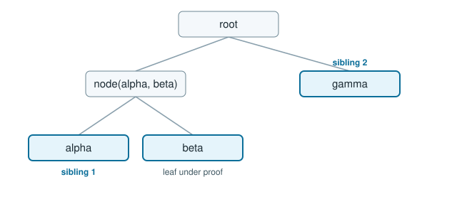

# Build a log and verify the proofs

This tutorial stores the three records from [getting started](../getting-started.md), checks the proofs a reader assembles from tiles, signs a checkpoint, and then builds a small indexed log. The tree shape is the [Merkle tree](../topics/merkle-tree.md) page. The program is `docs/examples/src/bin/tutorial.rs`.

```text
cargo run -q -p rfc9162-docs-examples --bin tutorial
```

From a new crate, the same calls need `rfc9162`, `rfc9162-tiles`, `rfc9162-log` and `tempfile` at the versions in [installation](../install/index.md). The snippets below are the program, split at the points where the output changes.

## Write three records

`PosixStore` is a directory. `Writer` takes the writer lock, appends each record, and writes the tree state last. With three entries the level-0 tile and the entry bundle are partial tiles of width 3. A full tile holds 256 hashes, so nothing is sealed yet and there is no key sidecar.



`beta` sits under the node of `alpha` and `beta`. Its inclusion proof carries `alpha`'s leaf hash, then `gamma`'s leaf hash. The figure marks those two siblings.

```rust
{{#rustdoc_include ../../examples/src/bin/tutorial.rs:store}}
```

## Read the proof back

`Reader` trusts the tree state the writer stored. `inclusion` builds the path from the tiles. That path is the same bytes `inclusion_proof` returns over the flat leaf slice, and `verify_inclusion` accepts it for `beta` at index 1.

```rust
{{#rustdoc_include ../../examples/src/bin/tutorial.rs:read}}
```

## Append and check consistency

A second writer opens the same directory after the first drops the lock. Appending `delta` moves the size from 3 to 4. `consistency` returns the proof from the earlier size, and `verify_consistency` accepts the earlier root together with the new one. Those three nodes are listed on the [consistency](../topics/consistency.md) page.

```rust
{{#rustdoc_include ../../examples/src/bin/tutorial.rs:grow}}
```

## Sign a checkpoint and open at that size

`Signer` is an Ed25519 key under the origin `example.org/log`. The seed here is the fixed 32-byte value used by the documentation programs, so the signature line is stable. `Writer::checkpoint` writes a signed note at `checkpoint`. `Reader::open_checkpoint` accepts the log when that note verifies under a trusted key and the origin matches.

The checkpoint body is the origin, the decimal size and the root in standard base64. The base64 line decodes to the size-4 root `42fc54eeb6352f90cc81fdd5791292cca3974a168208b395b06a76240b24884d`, which is the `later root` from [getting started](../getting-started.md). The line that follows the blank line is the signature. It begins with an em dash, then the key name, then the key id and signature.

```rust
{{#rustdoc_include ../../examples/src/bin/tutorial.rs:checkpoint}}
```

An inclusion proof at the checkpoint size still verifies for `beta`. The checkpoint covers four entries, so the path is the path in a tree of size 4.

## Index a log and prove the lookup

`rfc9162-log` stores lookup keys in sorted runs and appends each run's manifest as a log entry. The key function here splits an entry on spaces. The identity hash `SHA-256(entry)` is always a key as well.

`seal` writes the run for the unsealed tail and logs the manifest. The two entries occupy indexes 0 and 1. The manifest is logged at index 2. `find` returns the entry's inclusion path and the path of the manifest that located it. Both are at the current tree size, and the entry path verifies.

```rust
{{#rustdoc_include ../../examples/src/bin/tutorial.rs:index}}
```

## The whole transcript

```text
{{#include ../output/tutorial.txt}}
```

The [tiles how-to](../howto/rfc9162-tiles.md) covers packs, identity lookup and cosignatures. The [log how-to](../howto/rfc9162-log.md) covers ranges, compaction, recovery and the sidecar command.
